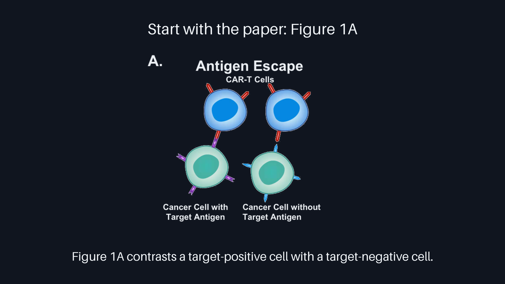

# Paper to Video Skill

[English](README.md) · 简体中文

[](https://github.com/Xingzhenqiu/paper-to-video-skill/actions/workflows/checks.yml)

**让读者看懂论文的关键实验和机制。** Agent 编排有来源的讲解，本地工具按已审阅分镜生成无声画面预览、字幕和后台证据页。

**v0.2.1-alpha：** 提供已审阅分镜的执行入口、真实论文无声案例、局部重做与首次运行检查。科学内容与视觉效果仍需要人工复查。

[](docs/media/antigen_escape.mp4)

[观看无声案例](docs/media/antigen_escape.mp4) · [本地预览](docs/demo.html) · [来源与署名](examples/antigen_escape/README.md)

案例使用 [Sterner & Sterner 的二零二一年综述](https://www.nature.com/articles/s41408-021-00459-7)中的图 1A 和选定原文，按 CC BY 4.0 署名，结合适配原图与定性动画讲解**抗原逃逸**。它只讲选定片段，不冒充全文解读或疗效比较。公开下载仅含代码和无声演示，默认预览无需声音录制、语音模型或 API Key。

## 先运行案例

下载完整仓库并解压，使用 **64 位 Python 3.12**。首次安装需要联网下载固定版本的两个依赖；默认案例不需要 API Key。请在仓库根目录打开终端。

Windows（无需激活虚拟环境）：

```powershell
py -3.12 -m venv .venv
.venv\Scripts\python.exe -m pip install -r requirements-demo.txt
.venv\Scripts\python.exe scripts/pipeline.py doctor
.venv\Scripts\python.exe scripts/pipeline.py validate examples/antigen_escape/project.json
.venv\Scripts\python.exe scripts/pipeline.py build examples/antigen_escape/project.json --output-dir outputs/antigen-escape
```

macOS / Linux（需先安装 Python 3.12）：

```bash
python3.12 -m venv .venv
.venv/bin/python -m pip install -r requirements-demo.txt
.venv/bin/python scripts/pipeline.py doctor
.venv/bin/python scripts/pipeline.py validate examples/antigen_escape/project.json
.venv/bin/python scripts/pipeline.py build examples/antigen_escape/project.json --output-dir outputs/antigen-escape
```

下文的 `python` 均指上述虚拟环境中的解释器。找不到 `py` / `python3.12` 时，请先安装对应版本的 Python；不要将这些终端命令粘贴到 Python 的 `>>>` 提示符中。

打开 `outputs/antigen-escape/video.mp4`。同目录有 SRT/VTT 字幕、`evidence.html` 和 `build_report.json`。无声预览按分镜设定的阅读与观看时长运行，不固定为五分钟；这是用于视觉检查的计划时长，不是实测语速或逐词对齐结果。已核验的默认输出为 1920×1080、24 fps、41.625 秒，共解码 999 帧；较小的试运行可加 `--width 640 --fps 12`，帧取整会使时长略有变化。

相同命令加 `--resume` 可复用通过哈希核验的未变内容。只修改 `s04` 的 `visual.title` 后恢复运行，再从构建报告核对实际复用了哪些画面片段。需要同时保存两版时，先复制原成片。[局部修改说明](docs/INCREMENTAL.md)列出预期行为与当前验证状态。

安装可能下载软件包；无声默认路径在本地渲染，不调用语音服务。运行时间取决于本机。音频导入和英文合成仍作为代码能力保留，须单独配置并在本地使用；公开下载不含语音文件和有声视频，见 [AUDIO.md](docs/AUDIO.md)。

## 安装 Agent skill

把完整的[技能文件夹](skills/paper-to-video/SKILL.md)放入宿主支持的目录。Codex 可用 `<你的项目>/.agents/skills/paper-to-video` 或 `~/.agents/skills/paper-to-video`，必要时刷新。也可请 skill installer 从[本仓库](https://github.com/Xingzhenqiu/paper-to-video-skill)安装 `skills/paper-to-video` 路径。

技能目录包含流程指令和轻量输入适配器；**渲染工具与案例需要完整仓库**。模型、凭证和 PDF 解析服务不随技能安装。

可以这样提出请求：

> 使用 paper-to-video，为目标读者讲解这篇文章。先核对来源、建立主张与证据对应表，并预览最难的科学结构。片长由内容决定，定位句保留在后台，每景围绕一个重点。明确还需要哪些科学或视觉复查。

## 工具和 Agent 各负责什么

| 环节 | 当前实现 |
|---|---|
| 输入 | UTF-8 文本或已核对 Reader 卡；原始 PDF/OCR 需要上游解析。 |
| 内容 | Agent 编写主张、讲稿和视觉计划；初始化不自动生成或验证这些内容。 |
| 来源 | 重新读取实际来源，核对哈希、文本单元、引文及原图资产。 |
| 画面 | 标题、保持比例的原图、已编排节点动画及简单柱图；不支持的组件明确报错。 |
| 声音 | 公开案例显式使用静音；PCM WAV 导入和英文 Kokoro 合成须单独配置，在本地使用。 |
| 同步 | 公开预览的字幕和动画使用分镜计划时长；单独配置的本地语音路径按实测片段运行，两者均不是逐词强制对齐。 |
| 修订 | 只重做变动内容及其依赖，复用核验后的其他片段。 |
| 复查 | 技术完整性与解码检查，和人工科学、视觉审核分别记录；本地语音使用另需试听。 |

新文章可先初始化：

```bash
python scripts/pipeline.py init article.txt outputs/my-paper/project.json --format text --article-type experimental
```

再编写并核对记录，见[执行说明](skills/paper-to-video/references/execution.md)和[输入契约](skills/paper-to-video/references/project-interface.md)。全文制作要求全文覆盖，选段必须说明范围。刚初始化的记录尚不能直接成片。

## 验证与边界

```bash
python -B -m unittest discover -s tests -v
python -B scripts/verify_package.py
python scripts/smoke_check.py --output-dir outputs/first-run-check
```

最后一条会实际生成小尺寸无声视频，核对完整解码、字幕、证据页及缓存，再只修改工作副本中的一个标题验证局部重做。它不改原示例，并拒绝覆盖已有非空目录；重新运行时请选择新的目录。检查报告位于该目录的 `smoke_report.json`。

**制作中文内容前配置字体：** 将有使用许可的中文 `.ttf` 或 `.otf` 放入你的项目目录，例如 `assets/NotoSansSC-Regular.ttf`，并在项目 JSON 的根级 `render` 中设置 `"font": "assets/NotoSansSC-Regular.ttf"`。默认字体仅适合西文；缺少字体时中文画面会在校验阶段报错。配置路径不代表所有字形均已覆盖，仍需查看实际预览。不要把字体拷进公共仓库，除非也核对了再分发许可。

仓库用 `.gitattributes` 关闭自动换行转换，保持来源及历史报告被哈希记录的原始字节。不要通过重写来源哈希跳过失败；旧克隆遇到该错误时，保留自己的修改，另下载最新版完整仓库重试。

[复现记录](docs/REPRODUCIBILITY.md)区分旧版测量和 v0.2.1 的本轮结果：新建 Windows / Python 3.12 环境，66 项测试通过，实际生成及检查无声视频。不改内容时 14 个缓存文件的字节和修改时间不变；只改标题时仅重做 `s04` 画面。工作流在 Windows、Linux、macOS 执行同一验收，徽章链接展示实际结果。这些是技术 Agent / CI 检查，不是真人试用或科学批准。发布前仍需对照来源核对结构并观看成片；单独配置的本地语音另需试听。

本版不承诺任意 PDF 自动成片、独立科学审计或优于其他系统。尚未进行同论文对照、跨平台端到端基准或五人试用。旧版[辛普森悖论合成教学案例](examples/simpson/render_demo.py)另行保留。

## 参与改进与许可

见 [CONTRIBUTING.md](CONTRIBUTING.md) 中可直接参与的小任务，以及[社区说明](docs/COMMUNITY.md)中的反馈、案例投稿与合作范围。[提交反馈](https://github.com/Xingzhenqiu/paper-to-video-skill/issues/new/choose)无需上传未公开论文或私人声音。案例明确同意后才会收录。

可自愿复制的致谢：

> 本视频使用 Paper to Video Skill 制作：https://github.com/Xingzhenqiu/paper-to-video-skill

不强制公开致谢、加星或添加水印。软件与 skill 使用 [MIT 许可证](LICENSE)，分发时应保留其中的版权与许可声明。论文素材和上游条款分别核对，见 [RIGHTS.md](RIGHTS.md)。
